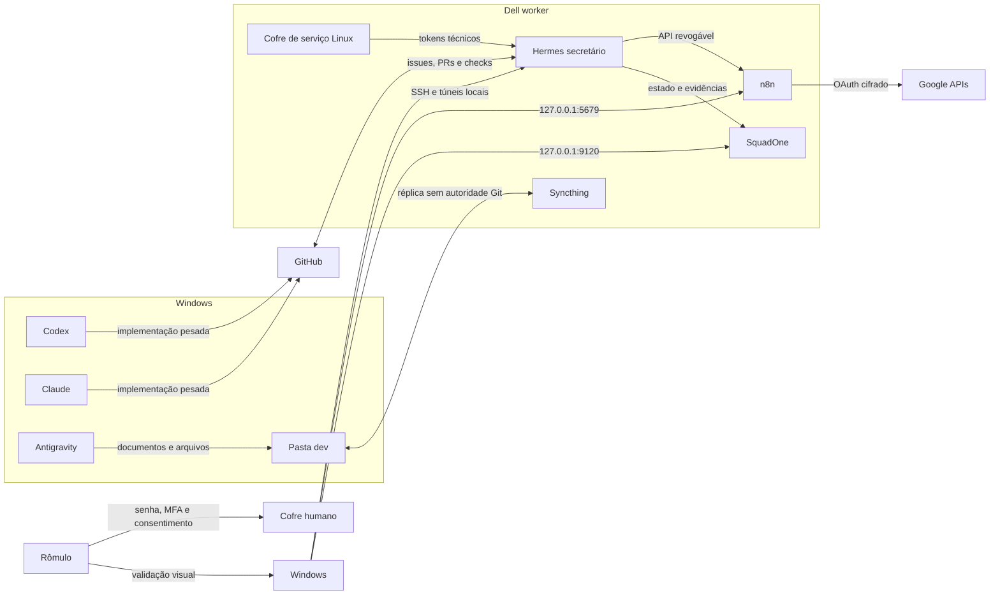

# Orquestração e segredos operacionais

## Visão-alvo

Hermes observa, classifica, encaminha trabalho pesado, valida o resultado e
registra evidências no SquadOne. Codex e Claude implementam. Antigravity
organiza documentação e arquivos. GitHub integra o trabalho versionado; o
SquadOne apresenta estado e evidências, sem receber segredos ou controlar a
infraestrutura.

## Estado confirmado em 21 de setembro de 2026

| Componente | Estado atual | Gap |
| --- | --- | --- |
| Acesso Windows → Dell | SSH por Tailscale e túneis automáticos | Nenhum gap de disponibilidade observado |
| n8n | Proprietário configurado e serviço saudável | Sem MFA, credenciais OAuth, chave de API, workflows ativos ou execuções |
| Hermes | Serviços saudáveis, GitHub autenticado e acesso aos arquivos sincronizados | Ainda não possui acesso autenticado à API do n8n |
| SquadOne | Central local saudável e somente leitura | Precisa receber leituras operacionais regulares do Hermes |
| Antigravity | Papel definido para documentação e arquivos | Fluxo e permissões ainda não estão tecnicamente impostos |
| Google | E-mail usado como login do proprietário do n8n | Drive, Calendar e outros serviços ainda não autorizaram OAuth no n8n |

O e-mail do proprietário não equivale a uma conexão Google. Uma credencial só
existe depois que o cliente OAuth, os escopos, o login, o MFA e o consentimento
forem concluídos.

## Onde cada segredo fica

| Camada | Guarda | Quem usa | Nunca guardar em |
| --- | --- | --- | --- |
| Cofre humano | Senhas, códigos MFA e recuperação, cópia da chave de cifragem do n8n | Rômulo | Hermes, Git, Drive sincronizado, skills e logs |
| Credenciais do n8n | Access e refresh tokens OAuth | n8n | Workflows, arquivos exportados e respostas de agentes |
| Cofre de serviço Linux | Chaves de API e tokens técnicos revogáveis | Hermes e serviços systemd | Repositórios, Syncthing, Drive e configuração pública do SquadOne |

O cofre humano é a autoridade de recuperação. O Linux deve conter somente os
segredos necessários para executar os serviços. Hermes recebe acesso delegado,
com escopo mínimo e possibilidade de revogação; ele não recebe a senha da conta
Google.

No Dell, o mecanismo recomendado para o cofre de serviço é
`systemd-creds`, vinculando as credenciais à máquina por TPM e chave do host e
entregando cada segredo somente ao serviço que o consome. O hardware possui
TPM, mas essa migração ainda não está ativa: ela exige ajustar as unidades
systemd com privilégio administrativo e preservar antes a recuperação no cofre
humano. Arquivos `.env` atuais continuam privados por permissão de filesystem,
mas são um estado transitório.

## Ordem de fechamento

1. Habilitar MFA na conta proprietária do n8n.
2. Guardar no cofre humano uma cópia de recuperação da chave
   `N8N_ENCRYPTION_KEY`, sem expor seu valor em logs ou repositórios.
3. Criar o cliente OAuth do Google e conectar primeiro a credencial necessária
   no n8n. O agente prepara configuração e callback; Rômulo executa senha, MFA
   e consentimento.
4. Criar uma chave de API exclusiva para o Hermes e guardá-la no cofre de
   serviço do Linux. O Hermes passa a consultar workflows e execuções e só
   altera recursos quando houver autorização explícita.
5. Ativar e testar cada workflow separadamente, começando por uma operação
   reversível e registrando a evidência no SquadOne.
6. Impor o fluxo do Antigravity para documentos e arquivos, definindo pastas de
   leitura e escrita sem acesso a segredos.

## Responsabilidade de execução

Codex pode instalar a estrutura do cofre de serviço, configurar serviços,
preparar callbacks, criar testes reversíveis, integrar a API do n8n ao Hermes e
publicar evidências no SquadOne. Rômulo precisa executar login, senha, MFA,
consentimento OAuth e guardar materiais de recuperação no cofre humano. A
criação de uma chave de API persistente deve ocorrer com confirmação no momento
em que a interface revelar a chave.
