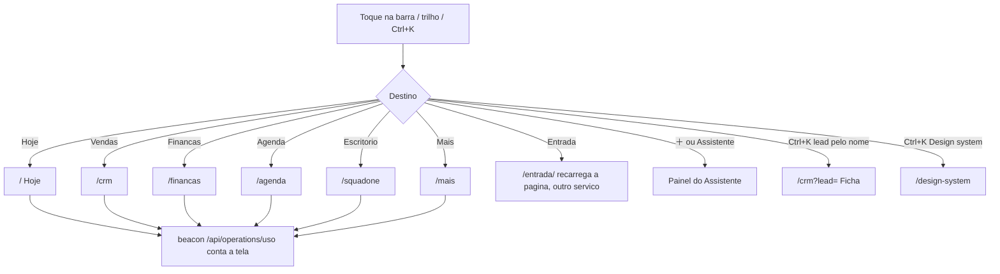
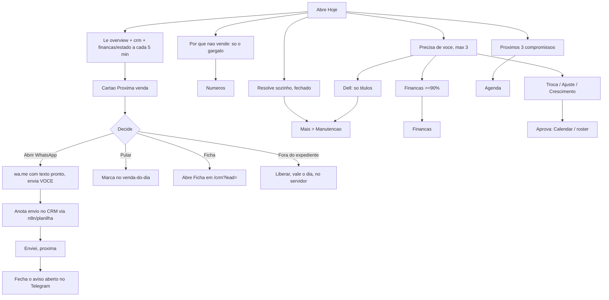
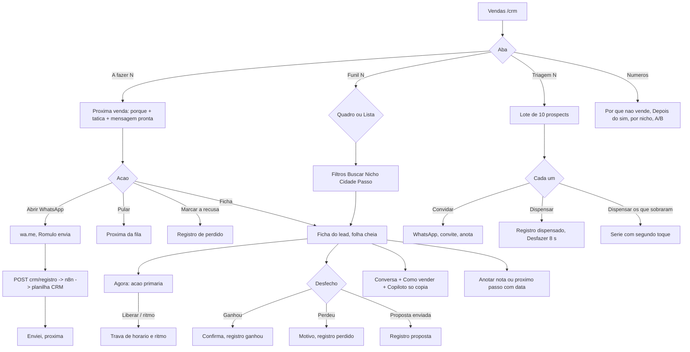
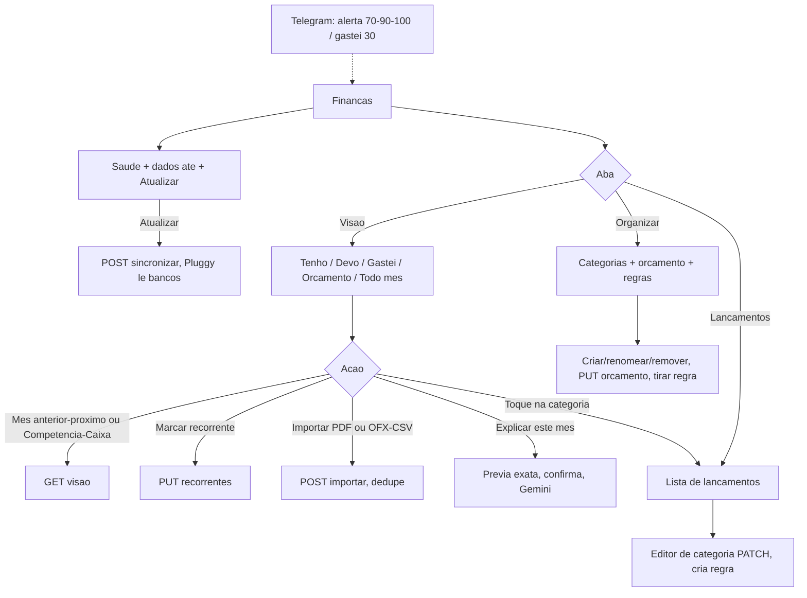
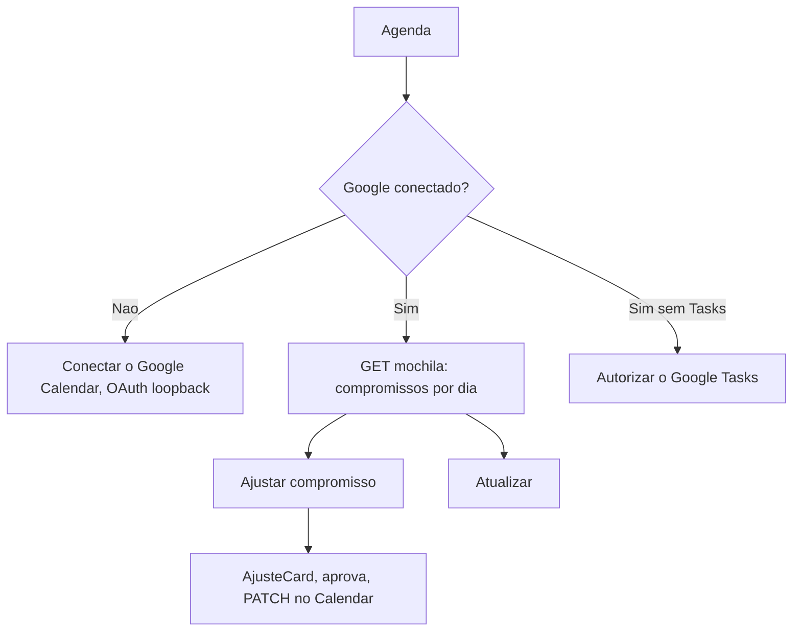
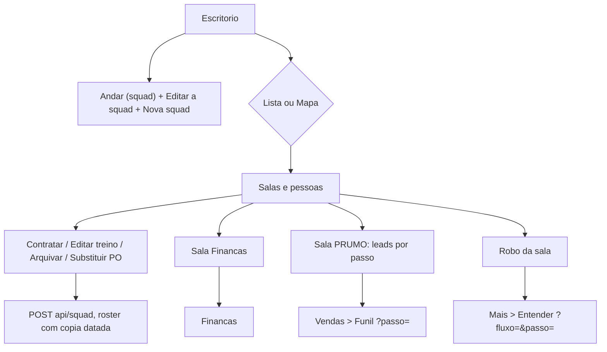
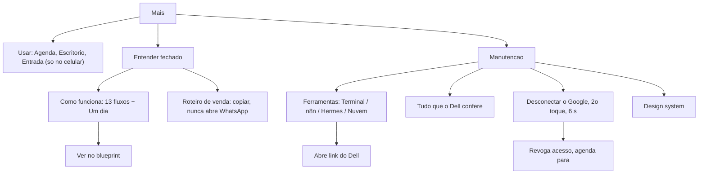
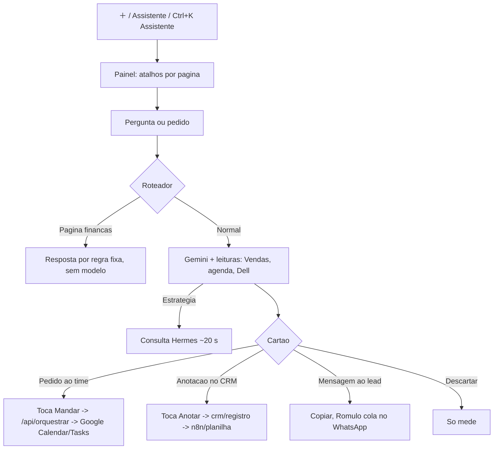
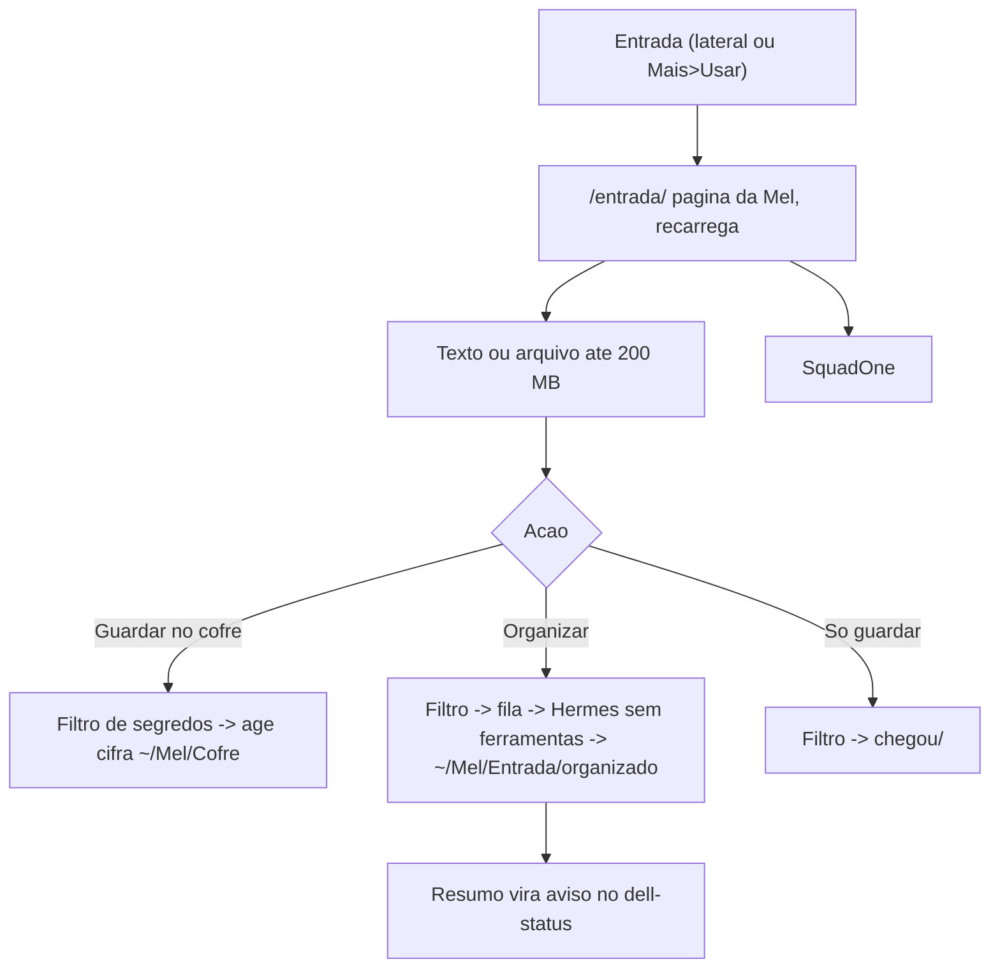

# Mensagens e jornadas: retrato de 17/10/2026

> **Registro de época.** Descreve a Central de 17/10/2026. Desde 19/10/2026 (`docs/auditoria-de-fluxos-2026-10-19.md`) a Próxima venda não é mais um cartão
> (`ProximaVenda.vue` saiu): a fila de venda alimenta a Ficha, o "Envie para X" do Telegram e a lista **Conversas para você**; as abas de Vendas se chamam
> Conversas para você, Primeiros contatos e Entender (Funil, Diagnóstico, Resultados); abrir o WhatsApp nunca registra envio; e o follow-up e o Perdido (7 dias)
> têm um dono só, a Central.

Levantamento feito antes do redesenho em três menus (Central de comando, Assistente,
Vendas). Parte 1: como uma mensagem de WhatsApp do lead vira ação. Parte 2: os fluxos de
cada item de menu, com o que manter, fundir, esconder ou cortar.

## 1. Mensagens

### 1.1 Como são lidas

```
Evolution 2.3.7 -> webhook -> evolution-adaptador.py (traduzir)
  -> respostas.jsonl (lead) e enviadas.jsonl (Rômulo)
  -> observador.py (ler_respostas, Conversas._anexar)
  -> ~/.local/share/whatsapp-conversas/<DDD + 8 últimos dígitos>.jsonl
  -> server/conversa-do-lead.ts (resumo PURO: última mensagem, link já mandado)
```

- Linha da conversa: `{em, direcao: entrada|saida, texto<=2000, origem, id?}`.
- Mídia vira marcador: imagem `[imagem] legenda`, vídeo `[vídeo] legenda`, documento
  `[documento] nome`, figurinha `[figurinha]`. Até 17/10 o áudio era `[áudio]` fixo, sem
  duração nem conteúdo: o sistema não sabia o que o lead disse.
- O lote de entradas (45 s sem mensagem) também vai ao n8n, onde o Gemini classifica.

### 1.2 Como são interpretadas

- O TypeScript não classifica resposta. `resposta.tipo` (negativa, exclusao, interesse,
  neutra, bot) vem só do Gemini do n8n (`whatsapp-conversa.py`).
- Regras determinísticas que sobram: a regra dos 5 min contra saudação, `resultados.ts`
  (`respondeuDeGente` = não é bot; `quisVer` = interesse), `colinha.ts` (só escolhe a
  resposta pronta) e `mandar-proposta.ts`.
- Até 17/10 não havia detecção de robô de atendimento (`[Atendimento X]`) nem de recepção
  (`*[Nome]*`), nem de negativa educada.

### 1.3 Como são trabalhadas

`montarHoje` cria o item "resposta"; `filaDeVenda` ordena; `fraseDaAcao` e `tatica` dão o
texto. Perdido: 7 dias sem mensagem, contados da última entrada. O copiloto roda só quando a
última mensagem é do lead.

### 1.4 Como são respondidas

Textos prontos (`site-mensagem`, `prumo-mensagem`, `plus-mensagem`, `colinha`,
`mandar-proposta`) abrem o `wa.me`; quem envia é o Rômulo, e o toque anota o envio.
O vendedor do Telegram avisa e nunca envia. Iris e estamparia não têm 2ª mensagem pronta.

### 1.5 O caso Baobá (Iris), por que o cartão errou

1. O lead mandou um áudio de 27 s: virou `[áudio]`, sem sentido para o classificador.
2. Rômulo perguntou "posso mandar o vídeo? Sem compromisso". O lead respondeu "CLaro, pode
   enviar sim.". O Gemini só via as mensagens DELE, nunca a pergunta, e "pode enviar sim"
   bate literalmente com "pode mandar" (sinal de interesse). Gravou `interesse`.
3. A frase "disse sim: combine a demonstração" é `fraseDaAcao('responder')` fixa para Iris.
4. Depois do vídeo, o cartão seguiu em "RESPONDER": `interesseParado` só se resolve com
   link, e vídeo é mídia, não URL.
5. "Respondeu ontem" usa a primeira resposta de gente; "Perdido em 6 dias" conta a última
   entrada, qualquer uma (inclusive robô).

Correções em andamento (17/10/2026): tipo `licenca` ("sim" a um pedido de licença não é
interesse), classificador com as últimas mensagens do Rômulo, papel `robo`/`recepcao` no
JSONL, vídeo/documento/imagem enviados contam como material (o cartão vira "perguntar o que
achou"), cartão nunca diz "disse sim" quando a última mensagem é nossa, e transcrição do
áudio do lead (Gemini, teto 20/dia, ≤120 s) com "áudio não ouvido" enquanto não há texto.

## 2. Jornadas por item de menu

Hoje a navegação tem 7 destinos e a Entrada é outro serviço. O desenho novo tem três
menus: Central de comando, Assistente, Vendas. Frequências abaixo são ESPERADAS pelo código;
o contador de uso (`/api/operations/uso`) não foi lido (o ssh para a Mel recusou a chave).

### 2.1 Navegação



### 2.2 Hoje



### 2.3 Vendas



### 2.4 Finanças



### 2.5 Agenda



### 2.6 Escritório



### 2.7 Mais



### 2.8 Assistente



### 2.9 Entrada

A Entrada não é Pedir, ditado nem Telegram: é a página privada da Mel em `/entrada/`
(serviço Python separado, repassado por `server/entrada-proxy.ts`).



### 2.10 Vereditos

| Item | Frequência esperada | Veredito |
|---|---|---|
| Hoje | Alta | MANTER como Central de comando, mais enxuta |
| Hoje, Próxima venda | Alta | FUNDIR em Vendas (a Central fica com o contador) |
| Hoje, Por que não vende | Média | FUNDIR em Vendas, Números |
| Hoje, cartão do Dell | Média | MANTER, número único (o chip do topo repete) |
| Hoje, Resolve sozinho | Baixa | ESCONDER em Manutenção |
| Agenda | Média | FUNDIR na Central |
| Agenda, Conectar Google | Raro | ESCONDER em Manutenção |
| Vendas, A fazer | Alta | MANTER |
| Vendas, Triagem | Média | MANTER enquanto os caçadores seguem pausados |
| Vendas, Funil | Média | MANTER a Lista; o Quadro vira opção |
| Vendas, Números | Baixa | MANTER; ESCONDER os blocos A/B |
| Ficha | Alta | MANTER |
| Ficha, Copiloto | Baixa | ESCONDER (flag) |
| Roteiro (em Mais) | Média | Perto de Vendas (botão em Entender) |
| Finanças, Visão e Lançamentos | Média | MANTER, abertas pela Central |
| Finanças, Organizar, Importar | Raro | ESCONDER |
| Escritório, Lista | Raro | ESCONDER em Manutenção |
| Escritório, Mapa | Raro hoje | VIRA o centro da Central |
| Mais, Usar | Média | CORTAR |
| Mais, Entender | Raro | ESCONDER |
| Design system | Raro | ESCONDER |
| Assistente | Provável alta | MANTER (é um dos três menus) |
| Pedir (folha) | Zero no Dell | CORTAR (o Assistente a substitui) |
| Ctrl+K | Baixa | MANTER como atalho: Assistente e leads |
| Entrada | Baixa | MANTER como faixa da Central |

Desnecessário de ver no dia a dia: o número do Dell repetido três vezes, o Mapa
isométrico fora da Central, o "Usar" do Mais, Organizar e Importação de Finanças, os 13
fluxos do Como funciona, os experimentos A/B, o Copiloto em teste, o Design system e o
Quadro do Funil.
