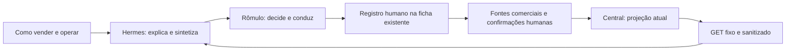

# Hermes na operação de RevOps e Sales Ops

Revisão: 25/10/2026. O Hermes é o secretário de leitura, diagnóstico e explicação; não é outra base comercial ou fechador. A disponibilidade qualitativa do Rômulo está confirmada e não foi convertida em horas, prazos ou permissão de envio.

## Como usar

Para “como fazemos vender e funcionar?”, o Hermes deve começar pelo modelo geral **Como vender e operar**, acessível em Configurações e no topo de Vendas. Explica oferta/limites, passagens, rotina, capacidade, indicadores e critérios de automação. Uma pergunta geral não deve terminar só numa lista de leads.

Para uma oportunidade, usa a skill `conversa-do-lead` e o leitor instalado `python3 ~/.hermes/scripts/ler_comercial.py`, com seleção `--nome` ou `--referencia` quando necessária. O CLI aceita somente esses argumentos, faz GET fixo à Central, não segue redirecionamento e recusa fonte antiga/contrato inválido. A seleção ambígua não é resolvida por memória ou nome parecido.

A resposta útil contém fonte/frescor, estado ou regra, evidência/lacuna, próxima ação interna, responsável e condição de conclusão/espera. A ficha vem da fonte da Central; o Hermes não monta endereço ou cria uma fila paralela. A classificação de um modelo, o clique em link e o recebimento de aviso não confirmam qualificação, proposta, aceite ou pagamento.

## Contrato de execução e decisão

| Entrada | Hermes faz | Saída verificável | Quem decide/executa depois |
| --- | --- | --- | --- |
| Pergunta geral sobre vender/operar | Consulta e explica o modelo comum, sem reduzir a resposta a casos | Procedimento, autoridade e limite claros | Rômulo conduz a rotina; cada executor mantém seu contrato |
| Oportunidade identificada | GET atual e leitura de qualificação, ciclo, responsável e bloqueios | Fonte atual/indisponível, lacunas e próxima ação interna | Rômulo confirma fatos e condições na ficha |
| Fonte inválida ou contexto conflitante | Declara desconhecido, conserva restrições | Conferência específica solicitada, sem nova abordagem | Operador confere fonte e identidade |
| Preço, negociação, contrato ou pagamento | Encaminha a decisão com as lacunas existentes | Ficha e decisão necessária, sem valor inventado | Rômulo negocia, valida documento e confirma cada marco |
| Falha técnica | Diagnóstico do que foi observado | Sintoma, evidência e impacto para correção autorizada | Codex/Claude; Socorro somente no contrato próprio |

## Caminho da informação

Não há seta de envio ou gravação automática do Hermes. O transporte Telegram/WhatsApp conserva seus próprios contratos e não recebe autorização nova por este modelo.

## Verificação realizada sem turno ou envio

- Gateway e painel estavam ativos na leitura de 25/10.
- Antes da alteração deste lote, SOUL e três skills instalados estavam iguais às fontes correspondentes do checkout Dell. Os alvos são `~/.hermes/SOUL.md`, `~/.hermes/skills/conversa-do-lead/SKILL.md`, `~/.hermes/skills/dell-operations-manager/SKILL.md` e `~/.hermes/skills/mapa-do-ecossistema/SKILL.md`.
- Leitor instalado igual ao fonte; consulta GET devolveu `somenteLeitura=true`, `contatoAutorizado=false`, fonte atual e lista sanitizada limitada a 20. Não foram retornadas conversas ou condições financeiras nesta auditoria.
- Token Google: seis escopos declarados `readonly`, arquivo 600. Isso não testa refresh/capacidade real das APIs nem a sessão do navegador.
- Cron: nove jobs, um habilitado. A leitura não alterou jobs nem copiou prompts. Ativo não é prova de resultado comercial.
- Configuração usa terminal local e presets `hermes-whatsapp`/`hermes-telegram`. O código desses presets inclui terminal, escrita/patch e cron; não há ferramenta `send_message` chamável diretamente nesses bundles, mas isso não prova impossibilidade de ação por outras capacidades.
- Serviço observado com `ProtectHome=no`, `ProtectSystem=no` e `NoNewPrivileges=no`. O papel comercial de leitura é uma regra operacional e não uma demonstração de sandbox completo.

## Instruções preparadas e carregamento sem reinício

O lote altera apenas quatro fontes versionadas: SOUL e as três skills acima. Elas passam a apontar o modelo geral da Central e distinguem procedimento geral de estado comercial atual. Não contêm cópia integral de catálogo, valores financeiros, horários de trabalhadores, transcrições ou nova base comercial. Papéis históricos desatualizados do SOUL foram ajustados para CRM/agenda da Central, n8n executor e Easypanel reserva fria.

A instalação deve comparar o baseline antes, guardar backup privado, substituir atomicamente e conferir hashes. Não precisa reiniciar o gateway para instalar arquivos. O código Hermes lê SOUL ao construir um agente fresco; a assinatura de cache não inclui mtime/hash de SOUL, e agentes já em cache conservam o prompt até renovação natural (idle TTL padrão de uma hora; sem override observado). Não se afirma recarga instantânea da sessão existente. A consulta `skill_view` lê o arquivo; seu dedup invalida por mtime/tamanho, e a descoberta tem TTL de 30 segundos. Aderência futura continua distinta da presença correta no disco.

Não executar turno, reset, reload ou mensagem de teste para “comprovar” carregamento. Reiniciar pode emitir aviso de desligamento; este lote preserva o gateway em execução. Próxima conversa legítima usa as instruções aplicáveis, e eventual sessão antiga é tratada com esse limite explícito.

## Falha, recuperação e aceite

Fonte indisponível é não verificada, nunca fila vazia. Identidade, pausa, recusa, espera, responsável humano e contexto atualizado continuam bloqueando ações incompatíveis. O operador mantém a decisão sobre condições, documento, cobrança e recebimento.

Aceite da área: modelo geral visível, leitor vigente sanitizado, alvos de instrução verificados e limites de autoridade/capacidade explícitos. Aderência numa interação natural exige observação futura sem fabricar evento. Isolamento completo de ferramentas não foi alterado por esta entrega e não é declarado concluído.

Reversão: restaurar somente as quatro instruções do backup após verificar mudanças posteriores; não alterar configuração, memória, cron, credenciais, ferramentas, serviços pessoais ou Silmer. A referência no painel pode voltar sem reescrever fatos do CRM.

## Implantação coordenada — 25/10/2026

A coordenação instalou as quatro instruções revisadas no Hermes e os mesmos fontes em `~/SquadOne`, com comparação dos hashes anteriores, troca atômica e backup privado em `~/.cache/mel-work/modelo-operacional-20261025/backup-hermes/`. Os quatro hashes finais conferiram. Gateway não foi reiniciado e nenhum modelo foi chamado; a construção de agente fresco ou a renovação natural do cache determina quando o SOUL novo entra em cada sessão. Não se declara recarga instantânea de sessões existentes.
